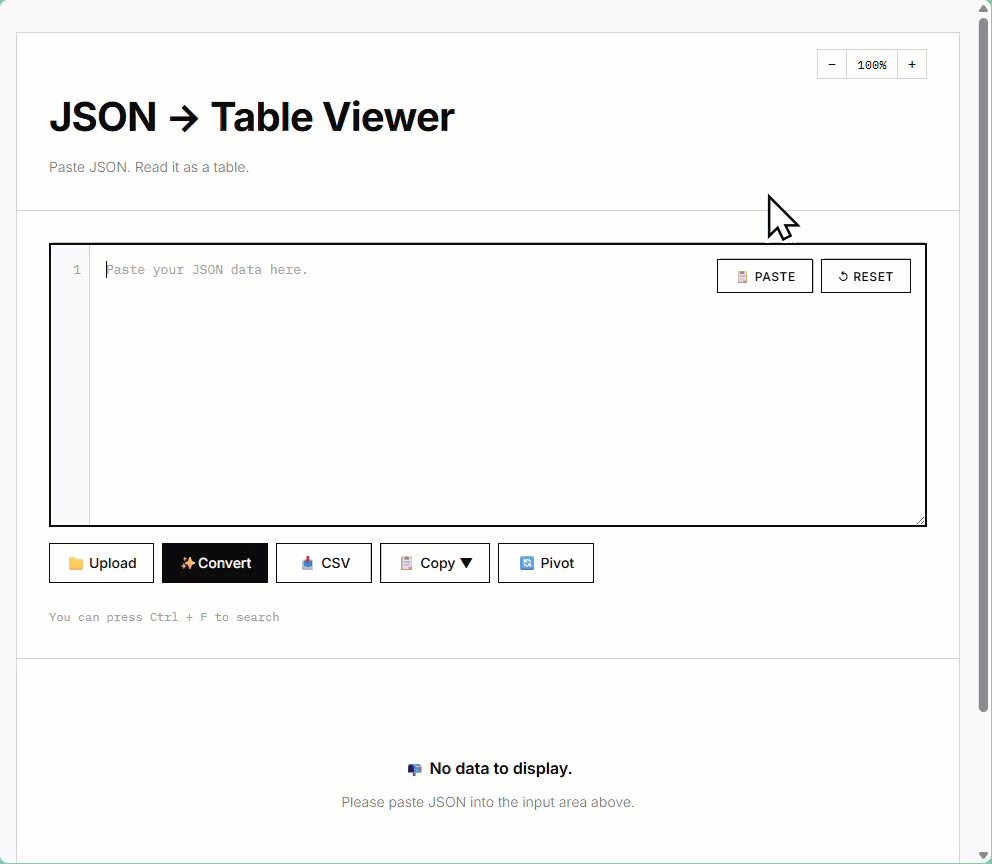
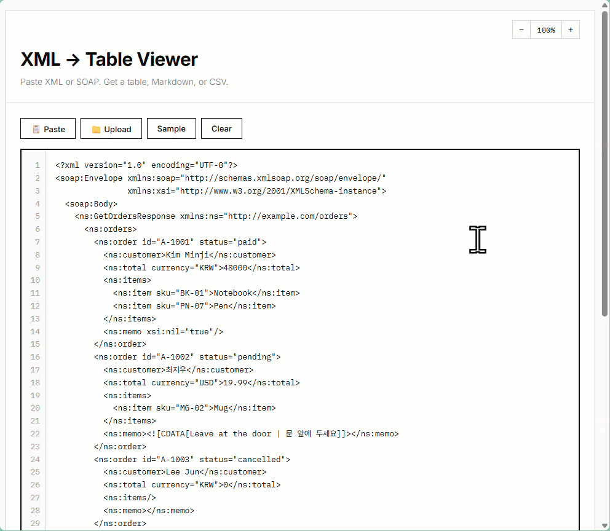
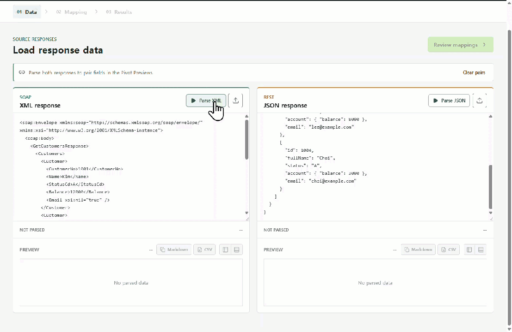
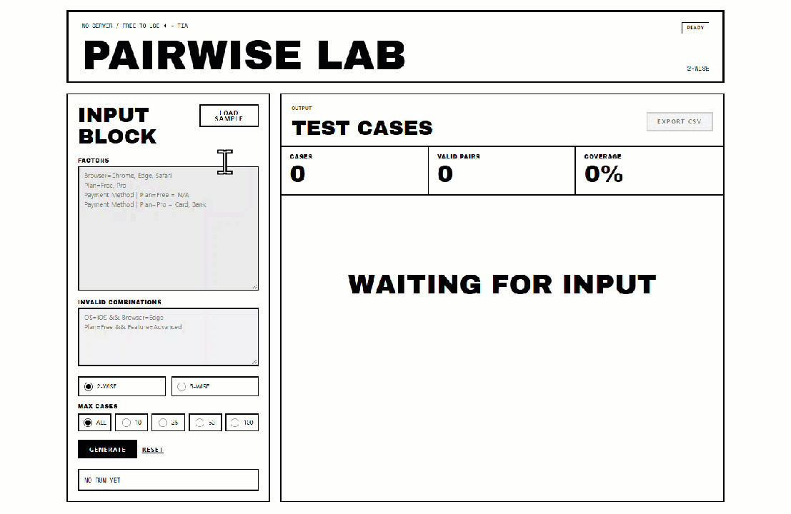

Hi!  
I make little things 😋  
I like making things,, but only when I know what I want.

### 🛠 Testing Tools

<table>
<tr><th>Repo</th><th>Description</th><th>Demo</th></tr>
<tr>
<td><a href="https://github.com/QA-Justice/json-table-viewer"><b>json-table-viewer</b></a></td>
<td>A Chrome extension that turns JSON into searchable, exportable tables</td>
<td>

view

</td>
</tr>
<tr>
<td><a href="https://github.com/QA-Justice/xml-table-viewer"><b>xml-table-viewer</b></a></td>
<td>A Chrome side-panel extension that turns XML and SOAP responses into a table</td>
<td>

view

</td>
</tr>
<tr>
<td><a href="https://github.com/QA-Justice/bridgecheck"><b>bridgecheck</b></a></td>
<td>Browser-based SOAP to REST migration response validator</td>
<td>

view

</td>
</tr>
<tr>
<td><a href="https://github.com/QA-Justice/pairwise-lab"><b>pairwise-lab</b></a></td>
<td>Pairwise test case generator</td>
<td>

view

</td>
</tr>
<tr>
<td><a href="https://github.com/QA-Justice/json-table-viewer-web"><b>json-table-viewer-web</b></a></td>
<td>A browser-based JSON table viewer, with Selenium and Cucumber tests</td>
<td>

view

</td>
</tr>
</table>

### 🍋 Side Project

| Repo | Description |
|---|---|
| **tiatya** | A personal AI agent you talk to on Discord, keeping records in an Obsidian vault |

한국어

 

안녕하세요!  
이것.. 저것.. 만듭니다 😋  
만드는 건 좋아하지만,, 원하는 게 명확할 때만 만듭니다.

### 🛠 Testing Tools

<table>
<tr><th>Repo</th><th>설명</th><th>Demo</th></tr>
<tr>
<td><a href="https://github.com/QA-Justice/json-table-viewer"><b>json-table-viewer</b></a></td>
<td>JSON을 표로 바꿔 보는 크롬 확장 앱</td>
<td>

보기

</td>
</tr>
<tr>
<td><a href="https://github.com/QA-Justice/xml-table-viewer"><b>xml-table-viewer</b></a></td>
<td>XML·SOAP 응답을 표로 펼쳐 보는 크롬 확장 앱</td>
<td>

보기

</td>
</tr>
<tr>
<td><a href="https://github.com/QA-Justice/bridgecheck"><b>bridgecheck</b></a></td>
<td>SOAP와 REST 응답을 필드 단위로 대조하는 도구</td>
<td>

보기

</td>
</tr>
<tr>
<td><a href="https://github.com/QA-Justice/pairwise-lab"><b>pairwise-lab</b></a></td>
<td>Pairwise 테스트 케이스 생성기</td>
<td>

보기

</td>
</tr>
<tr>
<td><a href="https://github.com/QA-Justice/json-table-viewer-web"><b>json-table-viewer-web</b></a></td>
<td>JSON Table Viewer 웹 버전, Selenium·Cucumber 테스트 포함</td>
<td>

보기

</td>
</tr>
</table>

### 🍋 Side Project

| Repo | 설명 |
|---|---|
| **tiatya** | Discord로 대화하며 Obsidian vault에 기록을 남기는 개인 AI 에이전트 |

